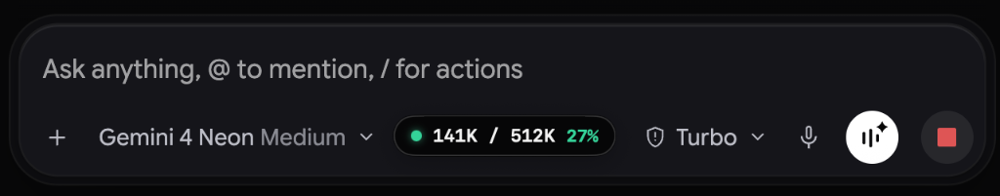
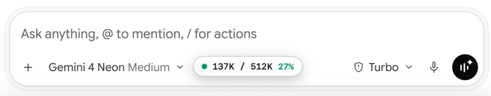

# Antigravity Context HUD for macOS

A lightweight, native **Swift / AppKit** floating HUD for **Google Antigravity 2.0** on macOS — see your live context usage, actual compaction cap (`256K` / `512K`), and prompt cache hit rate right beneath the input box, **without patching or modifying the Antigravity app**.

Built cleanly on top of [`ahmetdotsh/agy-context`](https://github.com/ahmetdotsh/agy-context)'s unmodified `analyzer.mjs` engine.




---

## Why This Exists

Antigravity 2.0's official Sidecar UI API currently only supports right-hand auxiliary pane tabs (`SIDECAR_UI_ENTRYPOINT_AUX_PANE`). If you want a subtle, always-visible status pill near the composer footer — without keeping the side pane open or injecting code into Antigravity's Electron bundle — this native macOS overlay fills that gap cleanly.

## Features

- **100% Read-Only & Local**: Zero client patching, zero process injection, zero external network requests, and zero extra LLM tokens. Reads Antigravity's local SQLite metadata & transcripts strictly read-only.
- **Actual Compaction Cap**: Pulls the real per-conversation `maxTokenLimit` (`256K` / `512K`) from local session metadata via `agy-context`'s `analyzer.mjs` — not just the model's theoretical 1M window.
- **Non-Activating & Draggable**: Built with `NSPanel (.nonactivatingPanel)` so clicking or dragging the pill **never steals focus** from Antigravity's input box. Drag it anywhere (e.g., right below the composer) and its position is saved automatically.
- **Auto-Show / Auto-Hide**: Automatically appears when `Antigravity` (`com.google.antigravity`) is frontmost and hides when you switch to other apps (configurable from the popover or menu bar icon).
- **Click for Full Breakdown & Per-Session Switcher**:
  - Color-coded compaction indicator (`<60%` green · `60–80%` amber · `≥80%` red)
  - Segmented usage bar + remaining tokens before compaction
  - Category breakdown (Tool Calls, System & Tools, Agent & Thinking, User Messages, MCP Tools, Skills & Rules)
  - Last-turn & whole-session prompt cache hit rates + compaction count
  - **Auto (Latest)** tracking or 1-click pinning to any recent conversation
- **Ultra-Lightweight**: Native Swift binary (`LSUIElement`, no Dock icon) + persistent local NDJSON bridge (~36 MB RAM, ~0.1% CPU idle, zero npm dependencies).

## Download (Recommended)

Grab the **signed & Apple-notarized Universal `.app`** (`arm64` + `x86_64`, ~283 KB) from the [**Latest Release**](https://github.com/spiljj/antigravity-context-hud-mac/releases/latest):

1. Unzip `AntigravityContextHUD-v0.1.0-macos-universal.zip` and drag `AntigravityContextHUD.app` to `/Applications`.
2. Double-click to launch (requires **macOS 14+** and **Node.js 22.5+**).
3. Optional: click the menu bar gauge icon → **Start at Login** for zero-friction daily use.

## Build from Source

If you prefer to compile locally (requires **macOS 14+**, **Xcode Command Line Tools**, and **Node.js 22.5+**):

```bash
git clone https://github.com/spiljj/antigravity-context-hud-mac.git
cd antigravity-context-hud-mac
chmod +x hud/build.sh
./hud/build.sh
open hud/build/AntigravityContextHUD.app
```

## Usage

Once launched:
1. Switch to **Antigravity** — the translucent pill appears near the bottom center of your screen.
2. **Drag** the pill to wherever you like (for example, just beneath the chat input box).
3. **Click** the pill to open the breakdown panel and real-title session switcher.
4. Use the **menu bar gauge icon** anytime to toggle *Show Cache in Pill*, *Auto-Hide Outside Antigravity*, *Start at Login*, reset position, or quit.

## Architecture & Upstream Sync

All macOS HUD code lives exclusively under `hud/`:

```text
hud/
├── bridge.mjs                 # Local read-only NDJSON bridge importing upstream analyzer.mjs
├── build.sh                   # Compiles & packages AntigravityContextHUD.app
└── macos/Sources/main.swift   # Native Swift/AppKit floating NSPanel + SwiftUI popover
```

Because `sidecars/context_panel/analyzer.mjs` is kept **100% untouched** from upstream [`ahmetdotsh/agy-context`](https://github.com/ahmetdotsh/agy-context):
- Syncing upstream parser/model updates is conflict-free:
  ```bash
  git fetch upstream && git merge upstream/main
  ```
- The original Antigravity sidecar plugin (`plugin.json` + `sidecars/context_panel/`) also remains fully intact if you ever want to install it as a side pane too.

## Credits & License

- Core token accounting & session metadata parser: [`ahmetdotsh/agy-context`](https://github.com/ahmetdotsh/agy-context) by Ahmet Sahin (MIT).
- Native macOS HUD & NDJSON bridge: MIT License — see [LICENSE](LICENSE).
