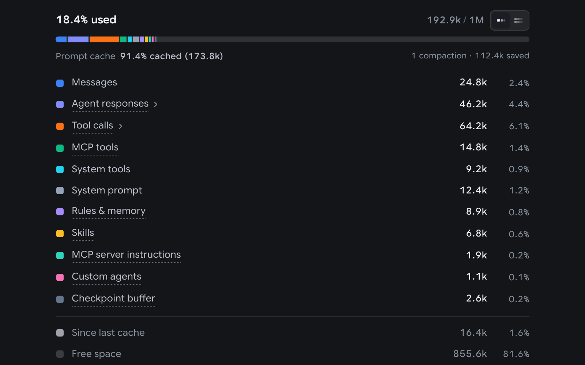

# Context for Antigravity

Inspect your live Antigravity context window in real time from a native sidecar panel, with zero extra LLM calls or token overhead.



## Install

```bash
agy plugin install https://github.com/ahmetdotsh/agy-context
```

## Features

- **Live conversation telemetry**: Updates automatically as turns complete, adapting its maximum context limit to the active model (`1M`, `200k`, `128k`, etc.).
- **Dual visualization**: Toggle between a proportional segmented usage bar and a `10x10` treemap grid with synchronized hover states.
- **Full category breakdown**: Inspect tokens across user messages, agent responses, tool calls, MCP schemas (active and deferred), rules, skills, and compaction savings.
- **Prompt cache & compaction stats**: See live cache hit percentage, cached token volume, and compaction history without leaving the IDE.
- **100% local**: Reads local session and workspace telemetry directly inside Antigravity.

## Usage

Open the panel using the sidecar `+` button (`Context`) or ask Antigravity:

> Open the Context panel for this conversation

## License

[MIT](LICENSE)
